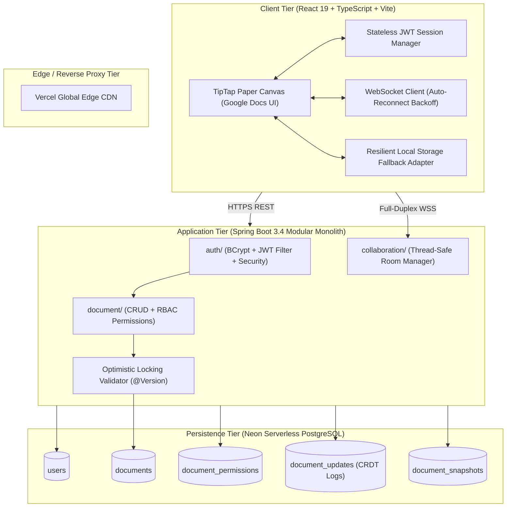

# DocSpace 📝 — Real-Time Collaborative Document Editor

[](https://frontend-theta-nine-penkfs8m9o.vercel.app)
[](https://neon.tech)
[](https://www.oracle.com/java/)
[](https://spring.io/projects/spring-boot)
[](https://react.dev/)
[](LICENSE)

**DocSpace** is an enterprise-grade, portfolio-quality collaborative document editor modeled after Google Docs. Built using **Java 21, Spring Boot 3.4, React 19, TypeScript, TipTap (ProseMirror), Yjs CRDTs, and Neon Serverless PostgreSQL**, with a recurring cloud hosting cost of **$0**.

---

## 🌐 Live Demos

* **Production Frontend:** [https://frontend-theta-nine-penkfs8m9o.vercel.app](https://frontend-theta-nine-penkfs8m9o.vercel.app)
* **Cloud Database:** Hosted on **Neon Serverless PostgreSQL (AWS us-east-2)** with automated Flyway migrations.

---

## 🏛️ System Architecture

DocSpace is structured as a **Modular Monolith** with clear domain bounded contexts, clean separation between DTOs and database entities, and resilient offline-first client adapters:



---

## ⚡ Concurrency & Distributed Systems Engineering

Collaborative editing presents unique concurrency challenges. DocSpace solves them across 4 architectural layers:

### 1. Conflict-Free Replicated Data Types (CRDTs)
* **The Problem:** When two users type concurrently at the exact same index, traditional locking or Last-Write-Wins (LWW) causes catastrophic data loss.
* **The Solution:** Uses **Yjs CRDTs**. Each character insertion is assigned a deterministic lamport clock and unique client identifier. Concurrent edits commute mathematically:
  $$\text{State} + \text{Op}_A + \text{Op}_B = \text{State} + \text{Op}_B + \text{Op}_A$$
  Edits converge deterministically across all peers without a centralized lock.

### 2. Database Optimistic Locking (`@Version`)
* **The Problem:** Preventing **Lost Update anomalies** when concurrent collaborators rename titles or modify sharing permissions.
* **The Solution:** `DocumentEntity` enforces JPA `@Version Long metadataVersion`. Writes issue:
  ```sql
  UPDATE documents 
  SET title = ?, metadata_version = metadata_version + 1 
  WHERE id = ? AND metadata_version = ?;
  ```
  Stale writes are intercepted, throwing `OptimisticLockConflictException` and returning **HTTP 409 Conflict**. Verified via automated suite in `DocumentConcurrencyTest.java`.

### 3. Server-Ordered CRDT Update Log
Every document has an ordered log of Yjs updates held by `CollaborationRoomManager`:
* **Join:** the client receives the whole log (`SYNC`), applies it, then sends whatever the server is missing, computed from the log's state vector. That one rule handles first load, edits made while a phone was offline, and messages lost when a socket died.
* **Edit:** keystrokes within 30 ms are merged into one `UPDATE`; the server assigns the next sequence number, relays it to everyone else and `ACK`s the sender (drives the *Saving… / Saved* indicator).
* **Compaction:** once the log grows past 100 entries a client sends a `SNAPSHOT` covering everything up to a sequence number, which replaces that prefix.
* **Persistence:** write-behind into `document_updates`; queued operations are written in one transaction per batch and retried on failure. A room stays in memory until its queue is flushed, so a document is only loaded from the database when the database is complete.
* **Security:** the handshake carries the JWT (`?token=&documentId=`); viewers can read but every write is rejected server-side. Rejections close with `4401` / `4403` / `4404` so clients stop retrying.

### 4. Mobile-Resilient Connections
`YjsSyncProvider` pings every 20 s and drops sockets that don't answer within 10 s (a phone that slept keeps a dead socket that looks open), reconnects immediately on `visibilitychange` / `online` / `pageshow`, and otherwise backs off with jitter up to 10 s.

---

## 🗄️ Database Schema & Flyway Migrations

All schemas are version-controlled in `backend/src/main/resources/db/migration/V1__init_schema.sql`:

```sql
CREATE TABLE users (
    id UUID PRIMARY KEY,
    email VARCHAR(255) NOT NULL UNIQUE,
    name VARCHAR(255) NOT NULL,
    password_hash VARCHAR(255) NOT NULL,
    created_at TIMESTAMP WITH TIME ZONE DEFAULT CURRENT_TIMESTAMP
);

CREATE TABLE documents (
    id UUID PRIMARY KEY,
    title VARCHAR(255) NOT NULL,
    content TEXT,
    owner_id UUID NOT NULL REFERENCES users(id) ON DELETE CASCADE,
    created_at TIMESTAMP WITH TIME ZONE DEFAULT CURRENT_TIMESTAMP,
    updated_at TIMESTAMP WITH TIME ZONE DEFAULT CURRENT_TIMESTAMP,
    metadata_version BIGINT NOT NULL DEFAULT 1
);

CREATE TABLE document_permissions (
    id UUID PRIMARY KEY,
    document_id UUID NOT NULL REFERENCES documents(id) ON DELETE CASCADE,
    user_id UUID NOT NULL REFERENCES users(id) ON DELETE CASCADE,
    role VARCHAR(20) NOT NULL, -- OWNER, EDITOR, VIEWER
    created_at TIMESTAMP WITH TIME ZONE DEFAULT CURRENT_TIMESTAMP,
    CONSTRAINT uq_doc_user UNIQUE (document_id, user_id)
);
```

---

## 🛠️ Tech Stack & Key Libraries

| Area | Technology | Purpose |
| :--- | :--- | :--- |
| **Frontend Framework** | React 19 + TypeScript | Type-safe, high-performance UI |
| **Bundler & Tooling** | Vite 8 + `@tailwindcss/vite` | Instant HMR and sub-second production builds |
| **Rich Text Editor** | TipTap 2.x (ProseMirror) | Headless rich-text editor engine |
| **Collaboration Engine** | Yjs CRDT | Decentralized conflict-free convergence |
| **Backend Framework** | Java 21 + Spring Boot 3.4 | Robust modular monolith REST & WebSocket server |
| **ORM & Data Access** | Spring Data JPA (Hibernate 6) | Relational mapping with optimistic locking |
| **Database Migrations** | Flyway | Strict, reproducible schema versioning |
| **Security & Auth** | Spring Security + JJWT 0.12 | BCrypt hashing & stateless JWT Bearer token authentication |
| **Database** | Neon Serverless PostgreSQL | Serverless Lakebase Postgres with auto-suspend |
| **Deployment** | Vercel (Frontend) + Neon (DB) | $0 recurring infrastructure costs |

---

## 🚀 Local Development Setup

### Prerequisites
* **Node.js:** `v20+` (Installed via Homebrew/nvm)
* **Java:** `OpenJDK 21+`
* **Maven:** `3.9+`

### 1. Clone the Repository
```bash
git clone https://github.com/<your-username>/docspace.git
cd docspace
```

### 2. Run the Frontend
```bash
cd frontend
npm install
npm run dev
```
Open [http://127.0.0.1:5173/](http://127.0.0.1:5173/) in your browser.

### 3. Run the Backend
#### Option A: In-Memory Database (Zero-Config Development)
```bash
cd backend
mvn spring-boot:run
```
*(Automatically uses in-memory H2 with PostgreSQL compatibility mode and runs Flyway migrations).*

#### Option B: Live Neon PostgreSQL Database
```bash
cd backend
DATABASE_URL="jdbc:postgresql://<neon-host>/neondb?sslmode=require" \
DATABASE_USERNAME="<neon-user>" \
DATABASE_PASSWORD="<neon-password>" \
mvn spring-boot:run
```

---

## 🧪 Testing

```bash
cd backend && mvn test          # room manager, WebSocket integration, concurrency
cd frontend && npm test         # sync provider against an in-memory server, UI state mapping
```

End-to-end, with backend and `npm run dev` running: four browser windows (laptop, iPhone, iPad, second laptop) type concurrently for 10 rounds, the phone drops offline and recovers, a window reloads, and a cold reopen must load identical content from the database.
```bash
cd frontend && npm run e2e      # APP_URL / API_URL / ROUNDS / HEADED=1 configurable
```

---

## 📄 License
MIT License. Free for educational and portfolio demonstration use.
